# Building a Multimodal (Voice-or-Text) AI Assistant with WebSocket APIs in Amplify Fusion

## Introduction

REST APIs are request/response: the client asks, the server answers, the connection closes. That is fine for CRUD operations, but it is a bad fit when a conversation needs to stay open across many turns - a chat session where the user might type, or might send a voice clip, at any point, and expects the same assistant to keep up either way.

A **WebSocket** solves this: the client opens a single TCP connection and upgrades it to a WebSocket, then both sides can send messages on that same connection at any time, in either direction, until one side closes it. In this lab, we will start with the simplest possible WebSocket round trip in Fusion, then build up to a WebSocket API that keeps a conversation open, inspects each inbound message to see whether it is text or audio, and routes it through Mistral AI accordingly - always ending in the same kind of reply, no matter how the question arrived.

### The Voice-or-Text AI Assistant

You will build a single WebSocket operation where, for as long as the connection stays open:

- If the inbound message is **text**, it goes straight to an AI chat model for a response
- If the inbound message is **binary (audio)**, it is transcribed to text first, then that transcript goes to the same AI chat model
- Either way, the client gets back a normal text reply, so from the client's point of view, voice and text are interchangeable ways of saying the same thing

The flow is described below:

1. The client (Postman) opens a WebSocket connection to the Fusion API
2. For as long as the connection is open, the client sends messages, each one either text or binary (audio)
3. If the message is binary, Fusion sends it to Mistral AI's Speech to Text action and gets back a transcript
4. The text message (or the transcript from Step 3) is sent to Mistral AI's Chat action
5. Fusion pushes the chat response back down the same connection
6. The client keeps sending messages - mixing typed and spoken questions - until it closes the connection

This data flow is illustrated below:

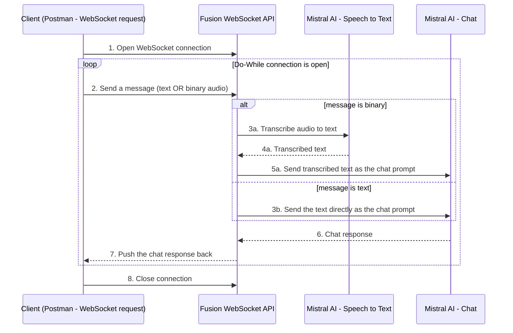

In this lab, you will learn the following:

- How to create a WebSocket API in Fusion Designer and prove out a simple request/response round trip with a Map component
- How to create the Mistral AI connections used by the full assistant use case
- How to wrap an integration flow in a Do-While loop so it keeps handling messages for as long as a WebSocket connection stays open
- How to branch a flow on whether the inbound WebSocket message is text or binary
- How to wire in Mistral AI's Speech to Text and Chat actions so voice and text converge on the same AI response
- How to test a mixed voice-and-text conversation with Postman

## Prerequisites

- Access to Amplify Fusion. If you do not have an account and need one, please send an email to amplify-fusion-training@axway.com with the subject line Amplify Integration Training Environment Access Request
- **Postman** (desktop, v10 or later) - recent Postman versions have a native **WebSocket Request** type alongside HTTP requests, which is what we use to test in this lab
- A **Mistral AI** account and API key - see the separate [Mistral account setup guide](mistral-account-setup.md) for step-by-step instructions
- A short pre-recorded audio clip (for example `.wav` or `.m4a`) to use as a test voice message, and its Base64-encoded form (`base64 -i yourfile.wav -o audio_base64.txt`) to paste into Postman's binary message box - see the [guide to recording and Base64-encoding a voice message](audio-to-base64.md) for step-by-step instructions (macOS and Windows)
---

## Lab 1 - Create the API and prove a basic WebSocket round trip

In this lab, we create a Fusion project and a new API whose frontend protocol is WebSocket instead of HTTP/REST, then prove out the simplest possible WebSocket round trip: take whatever text a client sends, stick `Axway University` onto the end of it with a **Concat** function, and send that back.

### Step 1 - Create a Fusion project

Create a new Amplify Fusion project for this lab. Use a unique name if you share the tenant with others (for example `XX_VoiceAssistant`, where `XX` is your initials). Choose **Project Type** as Fusion.

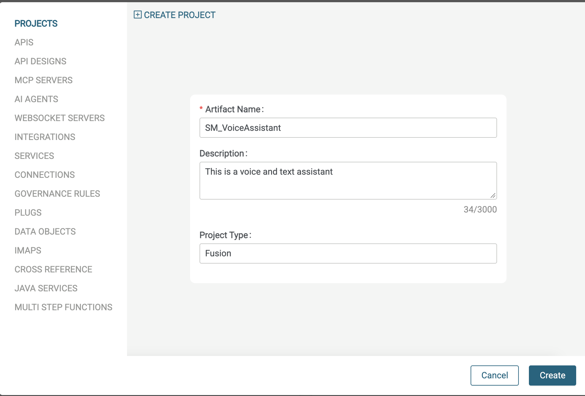

### Step 2 - Create a new WebSocket API

1. In your project, click the **+** symbol next to WebSocket
2. Give it a name, for example `VoiceAssistantAPI`

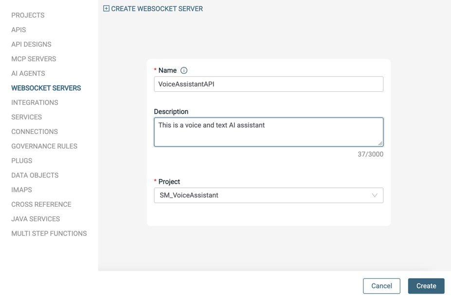

### Step 3 - Set the frontend base path

Open the API **Configuration** dialog and set a unique **Frontend Base Path**, for example `/XX_websocket`. This base path becomes part of the WebSocket URL you will connect to later (for example `wss://<your-data-plane-host>/XX_websocket`).

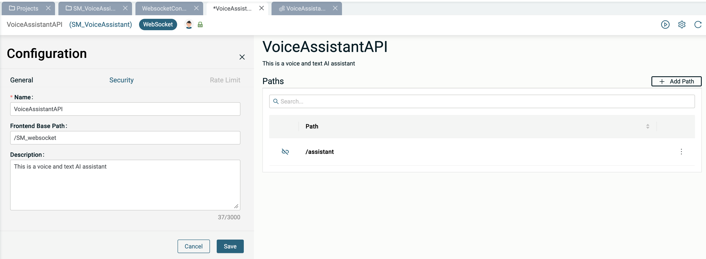

### Step 4 - Define the operation

Click **+ Add Path** and add a single operation for the connection, for example `/assistant`, which represents the path clients connect to.

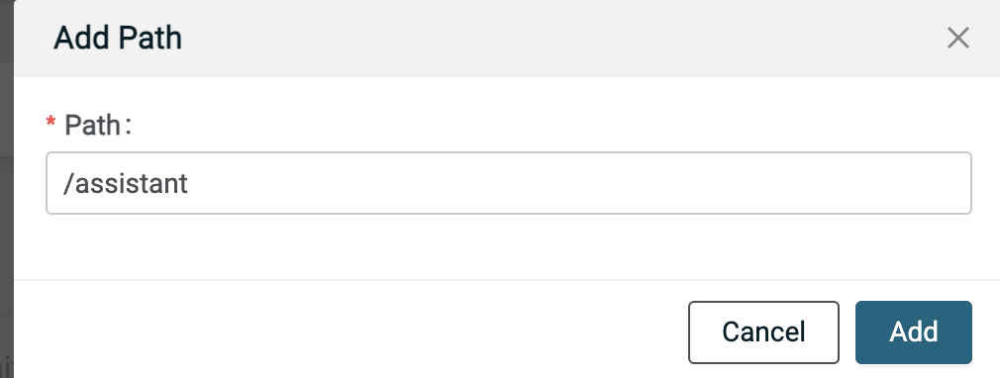

### Step 5 - Link an integration and add a Map component

1. On the operation, click the **link integration** button and choose **Create New Integration**
2. Name it, for example `VoiceAssistantFlow`
   
   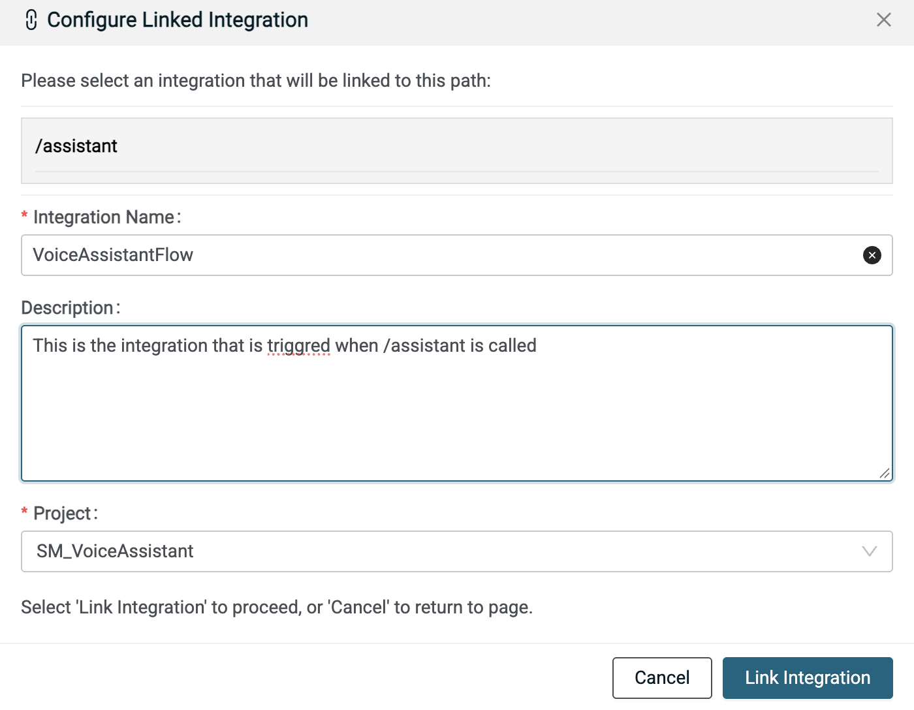

3. Immediately after the trigger (`WebSocket`), click the **+** symbol and add a **Map** component. Lable it as Send response. 
4. Label the WebSocket as Invoke WebSocket

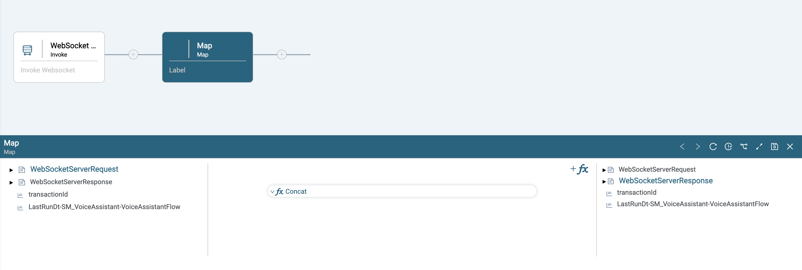

### Step 6 - Build the Concat mapping

1. Click on the Map component and maximize it to open the mapping panel
2. On the right-hand side, click **+ fx** next to `WebSocketServerResponse` and search for the **Concat** function under String.
3. Map the left-hand (pipeIn)`WebSocketServerRequest.textMessage` field into the Concat function's **inputString** field
4. On the Concat function's **concatWith** field, right-click and choose **Set Value**, then enter any text. Example your name. In this lab, we will be using  `Axway University`
5. Map the Concat function's **output** field to `WebSocketServerResponse.textMessage` (pipeOut)
6. Choose Save and close the map component.

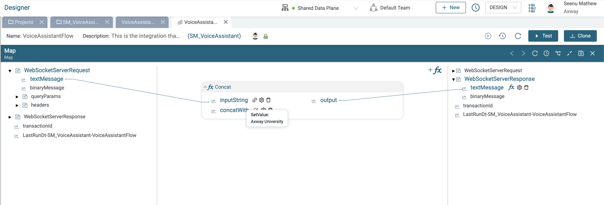

### Step 7 - Enable and test

Go back to the Websocket definition. Test it with Postman:

1. Activate the API and copy its URL.

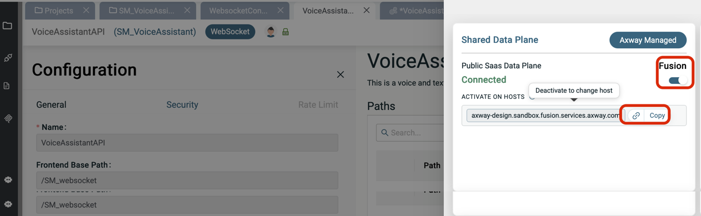

2. Connect to the WebSocket URL with a WebSocket request in Postman - use the URL you just copied and append the path (`/assistant`). Click **Connect**. Now a websocket connection has been made from Postman to Fusion.
3. Set the message type to **Text** and send a greeting, for example `Hello, `. Click on Send.
4. Confirm the response comes back as your greeting with `Axway University` appended to it, for example `Hello, Axway University`

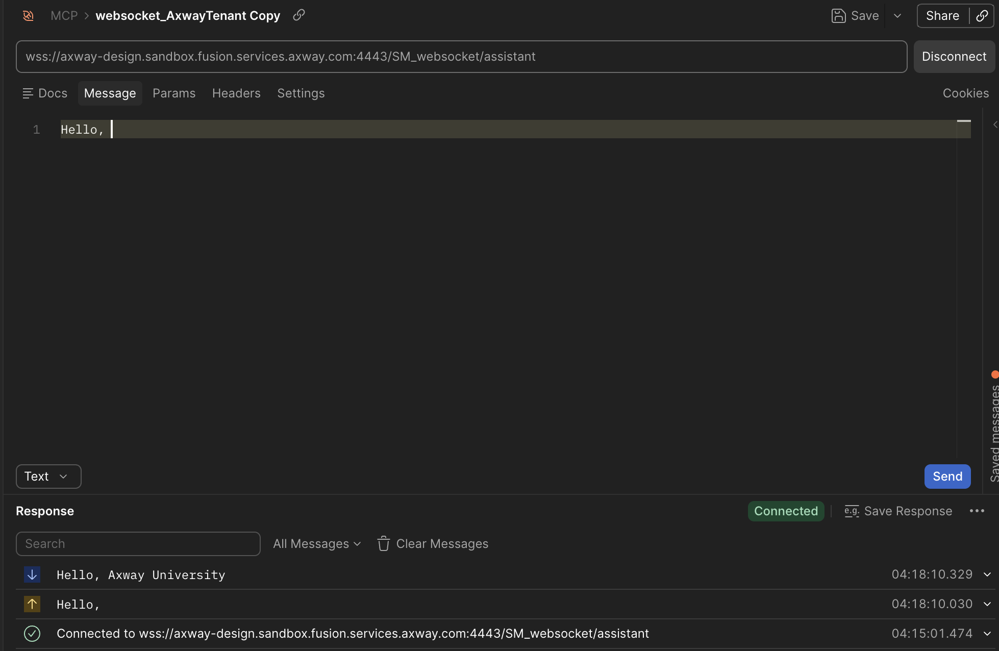

Send a few more requests like `How are you, ` and you must see that the response always is appended by your name.

Click on **Disconnect** after you have finished your testing and the websocket connection will be terminated. 

At the end of Lab 1 you have an open WebSocket API and have proven the basic round trip works in Fusion.
---

## Lab 2 - Build and test the voice-or-text assistant

In this lab, we create the two Mistral AI connections the integration will call (one for transcribing audio, one for generating chat responses), wrap the flow in a Do-While loop that branches on whether each message is text or binary, and test both paths end to end in Postman.

> Need a Mistral account and API key first? See the [Mistral account setup guide](mistral-account-setup.md).

### Step 1 - Set up the new path and wrap the flow in a Do-While loop

1. Deactivate the existing Websocket that was activated earlier. 
2. Add a new path and call it **/voiceassistant**
3. On this new path, click **Link Integration**, choose **Create New Integration**, and name it `VoiceAssistantFlow`
   
Immediately after the trigger (`WebSocket... Invoke`), Click on the + symbol and add a **Do-While** component so the flow keeps processing messages for as long as the client's connection stays open, rather than running once and stopping.

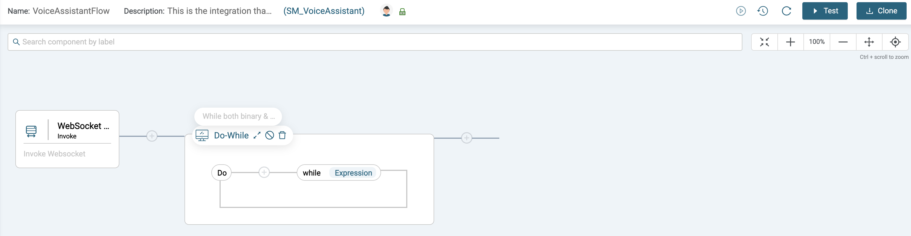

Add label to websocket Invoke as Invoke WebSocket.
Add label to DoWhile as While both binary & text are null

Click on the while expression and add two conditions

```
WebSocketServerRequest/binaryMessage Is Not Null
AND
WebSocketServerRequest/textMessage Is Not Null
```
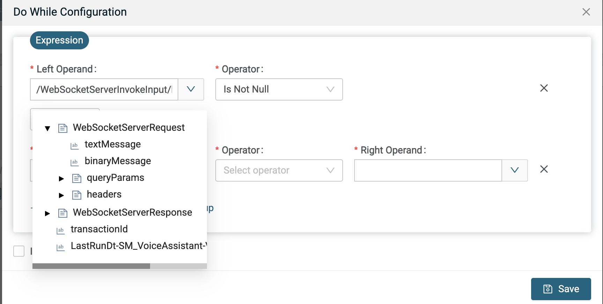

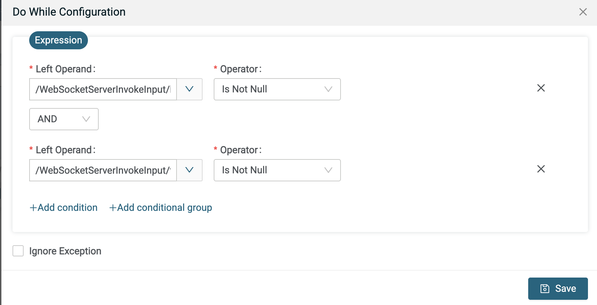

Click on Save

### Step 2 - Branch on whether the message is binary

Inside the **Do** block of the loop, add an **If-else** component labeled `Is it Binary`, with a condition expression that checks whether the inbound WebSocket message is binary. This is done by checking if there the binary input is not null

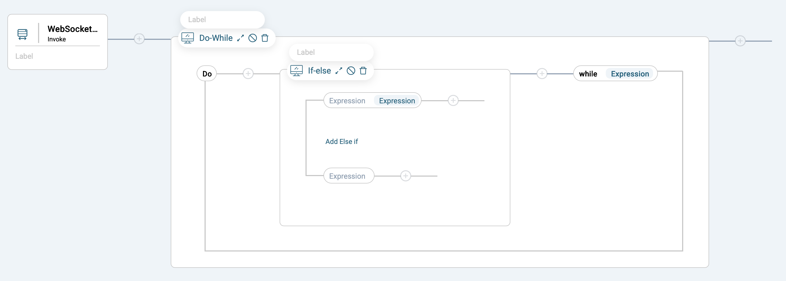


Click on the Expression inside the If-else. 

Click on +Add condition and add the following condition
```
WebSocketServerRequest/binaryMessage Is Not Null
```

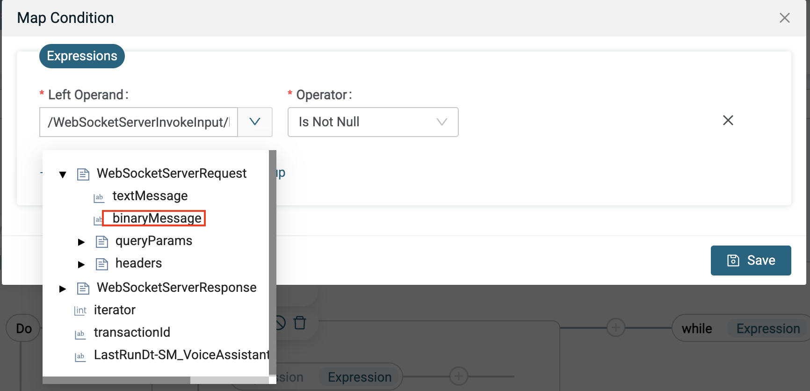

Click on Save
### Step 3 - Binary branch: transcribe, then chat

On the **If** (binary) branch:
Click on the + to add component. 

 Add the **Mistral AI Transcribe - Speech to Text** component. 

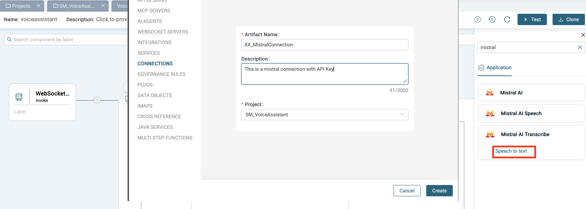

Expand the properties and click on Add next to connection
Provide a name to the new connection Eg: XX_MistralConnection. Click on Create


Leave the endpoint URL untouched.   Add a model name Ex: voxtral-mini-latest

Open Security dropdown and add the API Key that was generated earlier. Click on update and test your connection

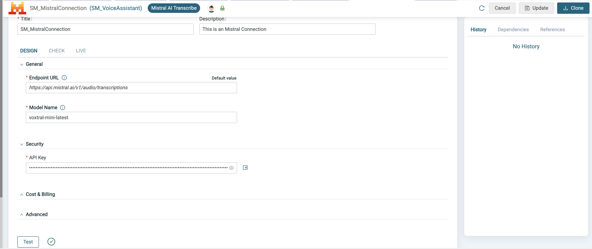

A green check signgifies a sucessful connection.
Close the newly created Mistral connection

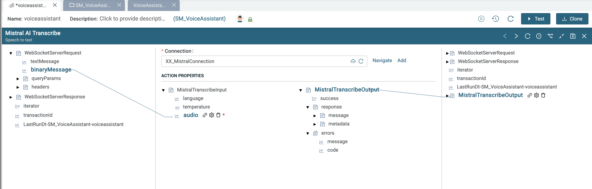

In the Websocket properties pipe in, join WebSocketServerRequest.binaryMessage to Action properties: MistralTranscribeInput.audio

Click on Save and close the Mistral AI Transcribe properties. 

Label the Mistral AI Transcribe as `Convert Speech to Text`

Click on the + symbol after Mistral AI Transcribe and add Mistral AI (Chat) component. Label it Generate Chat Response.

Expand the properties of Mistral AI component and click on Add next to Connection. 

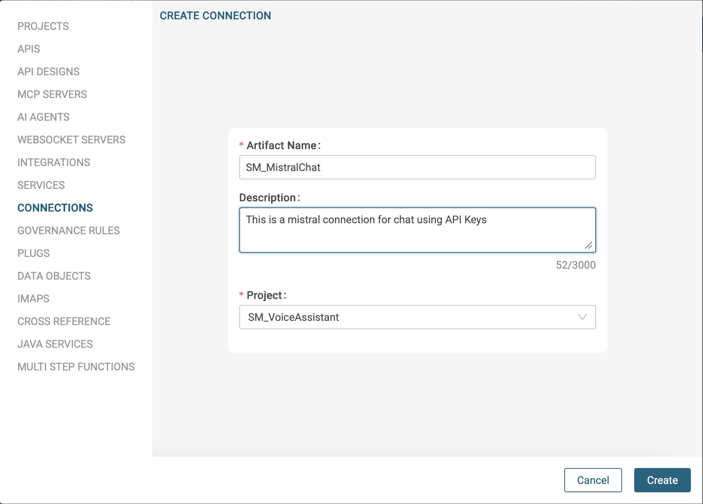

Provide a name to the new connection Eg: XX_MistralChat and an optional desciption. Click on Create

In the connection properties, leave the endpoint URL untouched. 

Enter the Model Name as: ministral-3b-latest. Use the API Key that was generated earlier. Click on Update. 

Test your connection. 

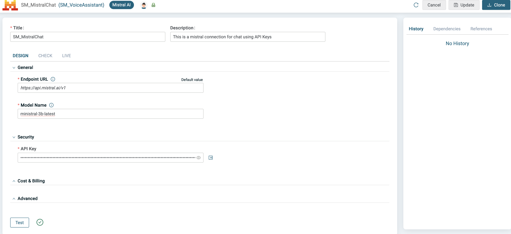

Close the connection properties. 

In the Mistral component:

Join MistralTranscribeOutput.response.message.text from the pipein to Action Properties: MistralAIChatInput.messages.text

In the Action Properties: Set MistralAIChatInput.prompt.text to `Answer concisely`

Join MistralAIChatOutput.messages.text to WebSocketServerResponse.textMessage

Click Save and close the Mistral AI properties. 

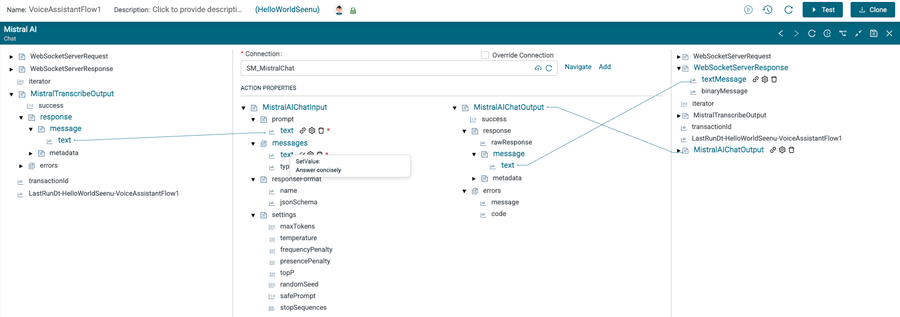

The integration must look like this.


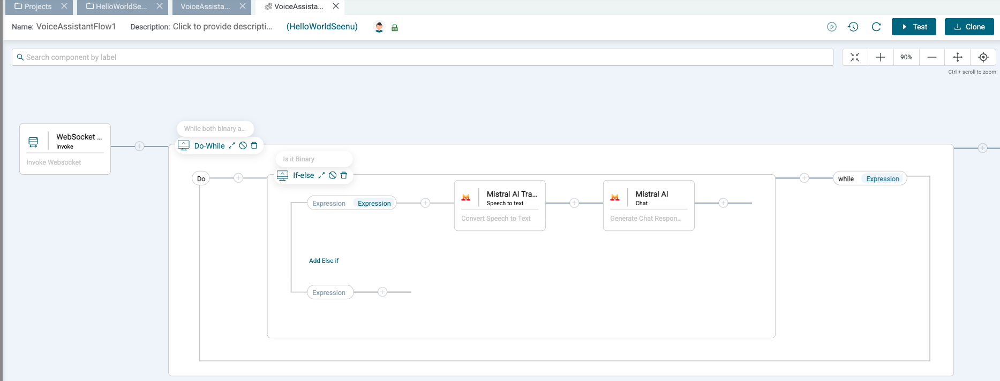


### Step 4 - Activate and test the binary branch

Go back to the WebSocket API Configuration:

1. Copy the URL.


2. Open Postman and use the URL you had copied earlier and append the path (/voiceassistant). Click on Connect. Now a websocket connection has been made from Postman to Fusion.
3. Set the message type to **Binary** and **Base64**.

   Our client, Postman, requires audio to be sent as Base64-encoded text rather than a raw audio file - see the [guide to recording and Base64-encoding a voice message](audio-to-base64.md) for how to produce this yourself.

   A ready-to-use example is already provided: [`audio_base64.txt`](audio_base64.txt) is the Base64-encoded form of a short recording asking "What is the capital city of India" - paste its contents into Postman's binary message box to test the binary branch end to end.

4. Click **Send** and you must have a response.

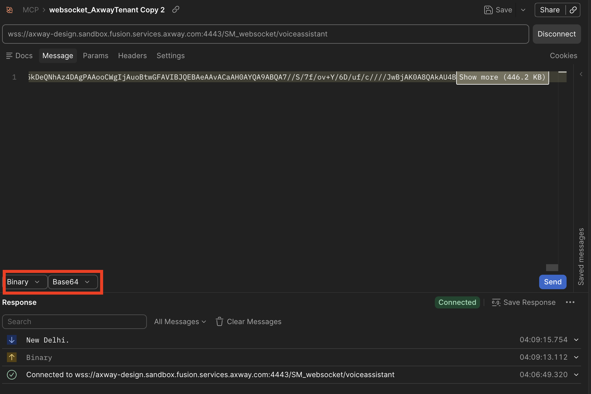

### Step 5 - Text branch: chat directly

We will now progress the else branch to respond to a text based chat.

Back in Fusion, Deactivate the API. 
Click on View integration next to /voiceassistant

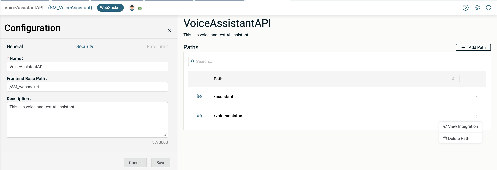

On the **Else** branch:

1. Add a **Mistral AI - Chat** component, and name it Generate Chat Response
2. In the connection, choose the previously created Mistral Chat connection. 
3. In the Pipe in Map `WebSocketServerRequest.textMessage` to Action Properties: `MistralAIChatInput.messages.text` 
4. Set the Action Properties: `MistralAIChatInput.prompt.text` to  `Answer concisely` and click save
5. Map Action Properties: `MistralAIChatOutput.messages.text` to PipeOut  `WebSocketServerResponse.textMessage`
6. Click on Save and close the Mistral AI properties

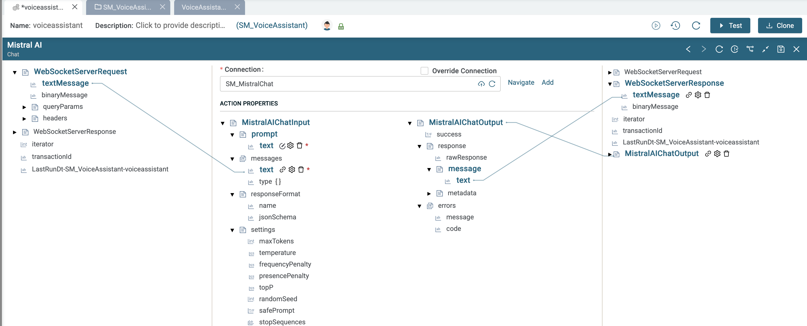


The final integration must look like this. 

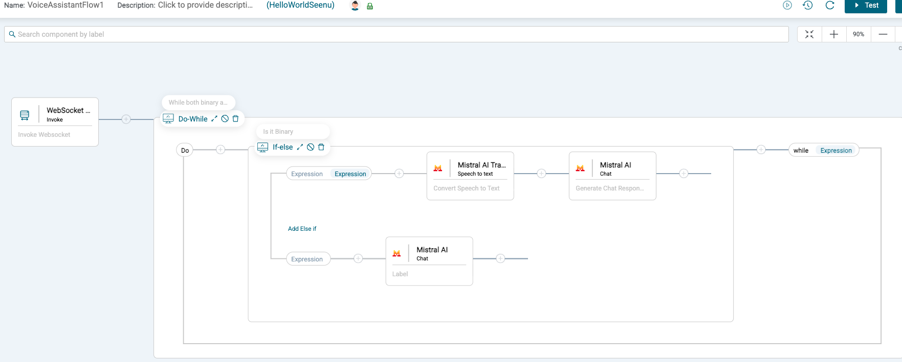

Activate the API

### Step 6 - Postman Mix it up (Voice and text), then disconnect

Send a few more messages, alternating text and voice, on the same connection, to confirm the Do-While loop keeps handling turns without you reconnecting. Want a different spoken question for each turn? Repeat the [recording and Base64-encoding steps](audio-to-base64.md) to produce a fresh voice message. Then click **Disconnect** in Postman.

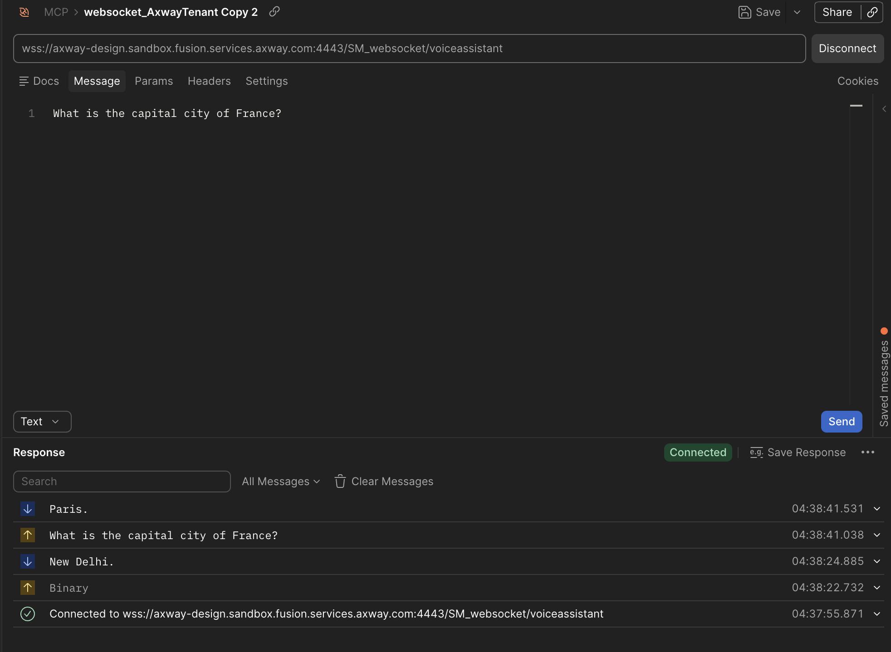

A single connection that answers both a typed question and a spoken one, without reconnecting in between, confirms the full chain works: Fusion told text and audio apart, routed audio through transcription first, and always finished with the same Mistral Chat call.

---

## Summary

You have built and tested a multimodal, multi-turn AI assistant over a single WebSocket connection, with no authentication anywhere on the client-facing side:

- **Lab 1** - created a WebSocket API in Fusion Designer and proved out a basic round trip with a Map component that concatenates an inbound greeting with `Axway University`
- **Lab 2** - created the two Mistral AI connections used by the flow (Speech to Text and Chat), built an integration wrapped in a Do-While loop that branches each inbound message on whether it is text or binary, routing binary messages through transcription before chat and text messages straight to chat, and tested a live, mixed conversation in Postman - typed and spoken questions, answered on the same open connection without reconnecting
