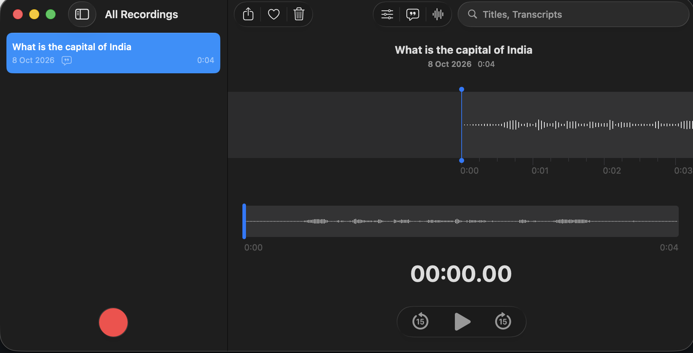

# Create a Base64-Encoded Voice Message for Postman

This guide covers recording a short voice clip and converting it into the Base64 text format Postman needs for a **Binary** WebSocket message, used in [Lab 2 of the WebSocket lab](websocket-lab.md#lab-2---build-and-test-the-voice-or-text-assistant).

Postman's WebSocket binary message editor only accepts Base64 (or Hex) text - there is no file-attach button - so any audio file has to be encoded to text first.

Steps are given for both **macOS** and **Windows** - follow the column that matches your machine.

> **Already have a sample ready?** A pre-recorded clip asking "What is the capital of India?" is included in this project folder as [`audio.m4a`](audio.m4a) (original recording) and [`audio.wav`](audio.wav) (converted, 16-bit PCM). If you just want to test the lab quickly, skip ahead to [Step 4 - Base64-encode the WAV file](#step-4---base64-encode-the-wav-file) using `audio.wav` directly - or use the already-encoded [`audio_base64.txt`](audio_base64.txt) and skip straight to [Step 5](#step-5---paste-it-into-postman).

## Step 1 - Record a short voice clip

Record a short question, a few seconds long, for example "What is the capital of India?".

### macOS

Use the built-in **Voice Memos** app to record the clip.



### Windows

Use the built-in **Sound Recorder** app (search for "Sound Recorder" or "Voice Recorder" in the Start menu) to record the clip. Click the microphone button to start, and again to stop.

Windows auto-saves the recording with no save dialog - there is nothing to export in Step 2, just a file to locate.

## Step 2 - Locate or export the recording

### macOS

Voice Memos has no direct "Save As", and newer versions may not show a "Save to Files..." option in the Share menu either - drag and drop is the most reliable method regardless of macOS version:

1. Open a Finder window to your destination folder (for example, this lab's project folder)
2. In Voice Memos, click and hold the recording in the list
3. Drag it directly onto the Finder window and release

This creates a standalone `.m4a` file in that folder, named after the recording.

> **Alternative:** If drag-and-drop does not work for you, click the **Share** icon (top-left, next to the heart and trash icons) and look for **Save to Files...** in the menu - some macOS versions offer it, others only show app targets like Mail, Messages, or AirDrop.

### Windows

Sound Recorder auto-saves each recording as an `.m4a` file in:

```
%USERPROFILE%\Documents\Sound recordings
```

Open that folder in File Explorer and copy the most recent recording into this lab's project folder (rename it to `audio.m4a` to match the commands below).

> If `Documents` is redirected to OneDrive, the same `Sound recordings` subfolder appears under your synced Documents instead.

## Step 3 - Convert to a standard WAV file

`.m4a` is a compressed container format; many speech/transcription APIs expect plain, uncompressed `.wav` (16-bit PCM) instead.

### macOS

The built-in `afconvert` command-line tool handles this with no extra installs. Open Terminal in the folder containing `audio.m4a`:

```bash
afconvert -f WAVE -d LEI16 audio.m4a audio.wav
```

- `-f WAVE` sets the output container to WAV
- `-d LEI16` sets the data format to little-endian, 16-bit signed integer PCM

Verify the result:

```bash
afinfo audio.wav
```

You should see output similar to:

```
Data format:     1 ch,  48000 Hz, Int16
Channel layout: Mono
```

### Windows

Windows has no built-in audio converter, so install **ffmpeg** first (one-time setup):

```powershell
winget install --id Gyan.FFmpeg -e
```

Close and reopen your terminal after install so it picks up the new `ffmpeg` command, then convert the file. Open PowerShell in the folder containing `audio.m4a`:

```powershell
ffmpeg -i audio.m4a -ar 48000 -sample_fmt s16 audio.wav
```

- `-ar 48000` sets the sample rate to 48 kHz
- `-sample_fmt s16` sets 16-bit signed PCM samples

Verify the result:

```powershell
ffprobe audio.wav
```

You should see a line similar to:

```
Stream #0:0: Audio: pcm_s16le, 48000 Hz, mono, s16
```

## Step 4 - Base64-encode the WAV file

### macOS

```bash
base64 -i audio.wav -o audio_base64.txt
```

This writes the Base64-encoded text to `audio_base64.txt`, ready to paste into Postman.

To copy it straight to your clipboard instead of opening the file:

```bash
cat audio_base64.txt | pbcopy
```

### Windows

In PowerShell:

```powershell
[Convert]::ToBase64String([IO.File]::ReadAllBytes("audio.wav")) | Out-File -NoNewline -Encoding ascii audio_base64.txt
```

`-NoNewline` and `-Encoding ascii` avoid adding a trailing line break or a byte-order-mark, either of which would corrupt the Base64 text.

To copy it straight to your clipboard instead of opening the file:

```powershell
Get-Content audio_base64.txt -Raw | Set-Clipboard
```

## Step 5 - Paste it into Postman

1. In your WebSocket request's message box, clear any existing text
2. Paste the contents of `audio_base64.txt` (or use the clipboard shortcut from Step 4: **Cmd+V** on macOS, **Ctrl+V** on Windows)
3. Confirm the two message-type dropdowns are set to **Binary** / **Base64**
4. Click **Send**