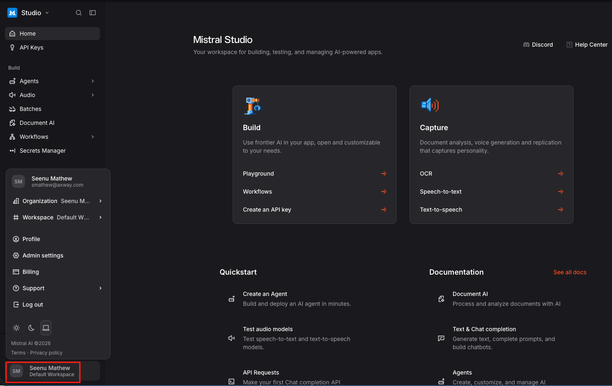
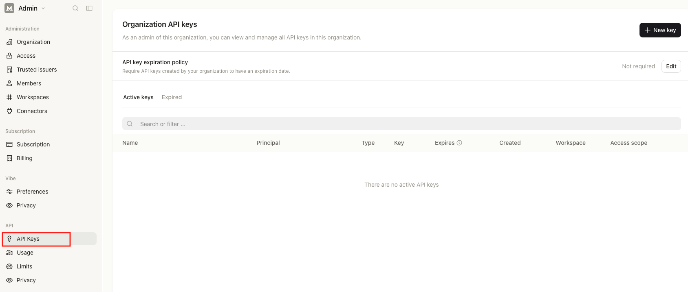
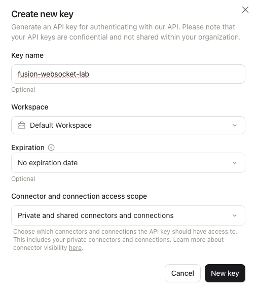

# Create a Mistral AI Account and API Key

This guide covers creating a free Mistral AI account and generating an API key, used by [Lab 2 of the WebSocket lab](websocket-lab.md#lab-2---build-and-test-the-voice-or-text-assistant) for the Speech-to-Text and Chat connections.

We will be using Mistral's free tier in this lab. 

## Step 1 - Sign up at La Plateforme

1. Go to `console.mistral.ai`
2. Sign up with an email address (or an existing Google/Microsoft account, if offered)
3. Verify your email.

## Step 2 - Create an API key

1. Click on your account name on the bottom left corner and choose Admin Settings
   

1. In the right hand side top corner, click on + New Key
2. Give it a descriptive name, for example `fusion-websocket-lab`. Choose a workspace (Default workspace) and an expiration date. 
3. Copy the generated key immediately and store it somewhere safe 

## Step 3 - Use the key in Fusion

Back in Fusion Designer, when creating the Mistral connections for Lab 2 (Speech to Text and Chat), paste this key into the connection's **API Key** / **Security** field.